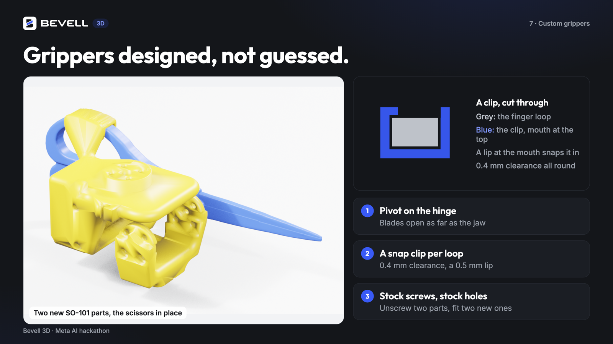

# Bevell 3D



Photos of an object on a printed sheet in. A true-size 3D model, editable CAD, a holder
to print and gripper pads for a robot arm out. Photograph a pair of scissors and it designs
custom grippers for the SO-101 arm instead (beta): new jaw parts with the scissors' pivot on
the gripper's hinge and a snap clip for each finger loop, tested in MuJoCo. Built for the
Meta Global AI Developer Hackathon (27 Oct to 4 Nov 2026).

## Try it

**Without a login:**
- **Examples:** open https://bevell.app/3d and tap "See examples": a bottle, a bracket, a gear,
  a mug, a hobby servo, a Mario figure, a fish toothbrush holder and a roll of tape, each with
  its model, CAD and files. Results open on Muse Spark's editable CAD where there is one.
- **Demo mode (a replay):** open https://bevell.app/3d?demo, tap "Make custom robot grippers"
  and take or choose the photos. No login, and no photos are uploaded (only how many there
  are). It replays a finished real gripper run of a pair of scissors in about 30 s, through the
  same screens, and opens its result: the grippers, the MuJoCo clip and the files. It is a
  replay, not a new scan.
- **A finished gripper run** on a real pair of scissors, from 11 photos:
  https://bevell.app/3d#result/d3d1fa28d05e

**A real run on your own photos:** print the sheet (the app links it), take the photos it asks
for, and paste your own Meta Model API key into the key field (used for that scan only, never
stored), or a Bevell API key on [Bevell Unlimited](https://bevell.app/pricing) (make one at
https://bevell.app/developers).

Daily limits: own-key runs 200 a day across visitors, Bevell Unlimited 20 per account a day,
demo replays 300 a day (`BYOK_DAILY_CAP`, `UNLIMITED_DAILY_CAP` and `DEMO_DAILY_CAP` in
`webapp/server.py`).

**Bevell**, the product this is built for: https://bevell.app (photos and scans to 2D CAD).

## What is new in this hackathon

Everything in this repository was written during the hackathon (27 Oct to 4 Nov 2026): the
first commit is 3 Nov 2026, 00:36 UTC. It is built for [Bevell](https://bevell.app), an existing product that turns photos and scans
into 2D CAD, but it uses none of Bevell's code or services: Bevell's own code is not here and
is not part of this submission. Joining the two later means calling this service from Bevell,
or Bevell's public API from here, never sharing code.

## What it does

1. Print `assets/bevell_capture_sheet.pdf` on A4 and put the object in the middle.
2. Take 11 photos with a phone, guided by the app: 6 from 45°, 4 from low down, 1 from above.
3. Upload them. Back come:
   - the model at true size, as STEP and STL;
   - CAD that fits the object: a revolve for turned parts, sketches and extrusions for
     prismatic ones (with a Fusion 360 timeline: level heights and hole diameters are named
     parameters), and smooth NURBS surfaces for freeform ones;
   - on request, an editable feature tree Muse Spark writes (revolve, extrude, loft, sweep,
     shell, fillet), checked against the photos, as a CadQuery program and a Fusion 360 script;
   - a holder to print: a pocket cut to the object's outline with 0.4 mm clearance, a
     filleted rim, a lead-in chamfer, finger notches and a chamfered foot, as STEP, STL,
     3MF (one tap opens it in Bambu Studio) and a DXF of its outline;
   - for a robot arm (SO-101): gripper pads shaped to the object, and a fixture with finger
     reliefs and a printed tag, with the pick given in the tag's frame so the arm's camera
     can find the part and grip it.

## How Meta's models are used

| Model | Through | What it does here |
|---|---|---|
| Muse Spark | Meta Model API | Reads the photos and plans the scan: what the object is, the prompt for SAM 3.1, whether it is flat, turned or freeform, and which photos are blurred or cut off |
| SAM 3.1 | Meta Model API | Masks the object in every photo; the masks carve the shape |
| SAM 3D Objects | Modal (L40S) | Builds the full shape from one photo and mask, for freeform objects; it is scaled and placed by the measured silhouettes |
| Muse Spark | Meta Model API | The CAD agent: writes a feature tree, sees per-photo diff images of where its model misses, and revises |

## How it works

```
photos on the capture sheet
  -> Muse Spark plans the scan
  -> 22 ArUco markers: the camera's focal length, and each photo's pose (0.2 to 0.3 mm)
  -> SAM 3.1 masks every photo
  -> visual hull (voxel carve), or a revolved profile, or SAM 3D fitted to the silhouettes
  -> CAD: revolve, stacked extrusions, a loft that stays on the scan, or NURBS patches; the
     holder, pads and fixture
  -> optional: Muse Spark writes an editable feature tree, tuned against the photos
  -> scissors (beta): the pivot screw found in the photo from above and put on the SO-101's
     hinge, a snap clip per finger loop, the scissors cut out, tested in MuJoCo
```

## Measured

**Live, on the deployed app** (5 Nov 2026, `tools/webapp_e2e.py`, which opens every file a
run returns): the bracket's photos came back as sketch-and-extrude CAD in 185 s (19 of 19 files),
the Mario figure's as smooth NURBS in 171 s (17 of 17), and 11 photos of a real pair of scissors
as custom grippers in 246 s (34 of 34). 89 tests pass (`pytest`).

**Fifteen objects with known true shapes**: ten scanned household objects from Google
Scanned Objects and five parts we designed (a bracket, an L-bracket, a gear, a sloped stand
and a hobby servo, the robot demo's part), photographed on the capture sheet in Blender (16 photos each) and run through the
whole pipeline with real model calls, then scored against the true meshes
(`tools/bench_table.py`):

| Object | CAD | Size off | Model to truth | Holder catch | Agent tree to truth |
|---|---|---|---|---|---|
| Vitamin bottle | revolve | 1.4 mm | 1.5 mm | none | 1.4 mm |
| Tape roll | revolve | 1.1 | 1.0 | none | |
| Camera lens | revolve | 0.8 | 0.7 | none | 1.1 |
| Bracket | sketch + extrude | 2.7 | 0.9 | none | 0.7 |
| L-bracket | NURBS | 1.5 | 0.9 | 0.25 | 0.7 |
| Gear | NURBS | 1.3 | 1.3 | 0.29 | 0.9 |
| Sloped stand | NURBS | 0.7 | 1.4 | 0.35 | |
| Mario figure | NURBS | 1.8 | 0.9 | none | |
| Android figure | NURBS | 0.9 | 1.7 | none | |
| Alarm clock | NURBS | 1.9 | 2.6 | none | 3.4 |
| Mug | NURBS | 0.4 | 3.6 | none | 1.8 |
| Letter holder | NURBS | 2.4 | 4.8 | 0.41 | |
| Fish toothbrush holder | NURBS | 1.3 | 4.4 | 0.74 | |
| White mouse | NURBS | 6.4 | 1.5 | 1.6 | 2.2 |
| Hobby servo | NURBS | 1.6 | 0.9 | 0.29 | 0.6 |

- Camera positions within 0.2 to 0.3 mm (median). Size within 2 mm on 12 of 15 objects.
- Runs vary: the bracket and gear, run again from the same photos, moved 0.8 and 0.4 mm in
  size and under 0.05 mm in surface distance (SAM 3.1's masks and SAM 3D's shapes differ
  from run to run).
- "Model to truth" is the mean distance from the true surface. Open insides a camera cannot
  carve from outside (the mug, the letter holder's compartments, the fish's cup) cost 3 to 5
  mm; Muse Spark's feature tree models the mug's inside and comes to 1.8.
- The white mouse is the known weak case: white on a white sheet is hard to mask. Put a
  coloured card under white objects.
- Holders are valid, watertight solids with every edge treatment; most do not touch the true
  object at all.

**Feature trees in Fusion 360:** 16 of 17 trees, hand-written, Muse Spark's (the servo's
included) and the prismatic route's, build the same body in Fusion and in CadQuery, within
0.6% in volume and 0.45 mm in size, with no failed step, and both refuse the same impossible
one (`tools/fusion_e2e.py`, through the BevellBridge add-in). Both kernels pick a fillet's or
chamfer's edges by where they lie and cap it under the smallest round its edges run along.
The seventeenth, Muse Spark's richer mouse, is a six-section loft 0.65 mm apart on 128 mm
(volume +0.6%): Fusion's and OpenCascade's smooth lofts interpolate differently between
sections. Every OpenCascade loft setting was tried across all 17 trees in Fusion: the one
used passes 16, the others 15 and 14.

**Smooth NURBS:** Mario's 1,464 patches lie 0.06 mm from the scan and 0.93 mm from the true
figure (the scan itself is 0.92), and open in Fusion as one solid.

**What people do to photos** (`tools/user_tests.py`, the real pipeline): the minimum 8 photos,
photos from one side only, blurred, dark, shrunk to 640 px, 48 MP, rotated by their EXIF tag,
PNG and iPhone HEIC all come out within 2.5 mm of the true size. An unreadable photo is skipped
and named; photos of another object mixed in are left out. Sixteen copies of one photo, and
photos cropped so the sheet is gone, are refused with what to do instead. 13 of 13 pass (5 Nov 2026). The web API is covered by 54
tests (access, own API keys, Bevell Unlimited keys, demo replays, daily caps, file types,
ids, path traversal).

**Robot fixture:** the printed tag is found by a camera at its id and size, and its pose 300 mm
away within 3 mm (`tests/test_fixture.py`, `tools/pick_preview.py`). The tag PDF's second
page is tag 41, for a second print of the fixture as the place station.

## Run it

```bash
python3.12 -m venv .venv && .venv/bin/pip install -r requirements.txt
export MODEL_API_KEY=...   # Meta Model API
.venv/bin/modal deploy modal_app/sam3d.py      # SAM 3D on Modal, for freeform objects
.venv/bin/uvicorn webapp.server:app --port 8300
```

Then open http://localhost:8300 on a phone or a laptop. A deployed copy runs at
https://bevell.app/3d (`modal_app/web.py` on Modal); see "Try it" for how to use it.
`python -m bevell3d.run --out out/x photos/*.jpg` runs the same pipeline from the command line.

To build a feature tree inside Fusion 360, start the BevellBridge add-in
(`fusion_bridge/BevellBridge`) and run `python -m tools.fusion_e2e`.

## Custom robot grippers for a tool (beta, SO-101)

"Make custom robot grippers" on the start screen takes the same guided photos of a pair of
scissors lying flat and closed, and returns two new parts for the SO-101 that replace its own
moving jaw and wrist-roll follower (`bevell3d/custom_jaws.py`). Unscrew the stock parts, screw
these on with the same screws, and snap the scissors in. The design is deterministic: the
models measure and fill in, the geometry is computed.

- **The pivot is the screw.** The photo taken from above is flattened onto the sheet at 0.1 mm
  a pixel and the screw found as the innermost circle near the tool's axis
  (`bevell3d/tool_geometry.py`). On the real pair it is 0.3 mm off the axis. The pivot goes on
  the gripper's own hinge (from the official SO-101 MJCF), with the scissors beside the gripper,
  so the blades open exactly as far as the jaw.
- **The outline** comes from the photos from above; the finger holes come from SAM 3D when it
  agrees with the photos on the outside edge, because the masks of clear plastic handles fill
  the holes. Loops that touch each other are split at their shared wall.
- **A snap clip per finger loop:** a channel round the loop with 0.4 mm clearance, and one lip
  on the wall away from the arm (the arm stiffens the wall it joins), so the loop snaps in past
  a mouth 0.5 mm narrower than itself.
- **The scissors are cut out of both parts** with 0.4 mm clearance, and from the fixed part the
  moving half's whole sweep, so nothing stands where the scissors are or go.
- **Arms** are rounded hulls from each clip to the jaw's own surface, blended in with a 4 mm
  fillet (`bevell3d/blend.py`). Every layout (side, loops forward or back, either way up) is
  checked for collisions over the stroke and the first clear one kept.
- **Tested in MuJoCo** before anything is printed: on the live run the gripper's 25.8 degrees
  open the blades 25.8 degrees, the blades are shut with the gripper closed, and nothing
  collides. The result page plays the simulation.
- **To print:** `custom_jaws.3mf` holds both parts flat on the plate for Bambu Studio. The first
  print of these parts is in progress; the snap fit is not yet proven in plastic.

## Credits

- Benchmark objects: [Google Scanned Objects](https://research.google/blog/scanned-objects-by-google-research-a-dataset-of-3d-scanned-common-household-items/),
  CC BY 4.0, via Gazebo Fuel's GoogleResearch collection.
- SAM 3D Objects and SAM 3.1 by Meta.
- The SO-101 gripper's model and jaw meshes (`third_party/so101`): The Robot Studio's
  [SO-ARM100](https://github.com/TheRobotStudio/SO-ARM100), Apache License 2.0.
- MuJoCo by Google DeepMind, for the scissors simulation.
- MIT licence for the code. The Bevell name, logo and wordmark (`webapp/static/logo-icon.svg`,
  `webapp/static/bevell-wordmark.svg`) are Bevell's trademarks and are not covered by it.
